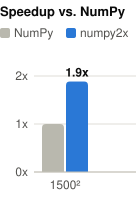
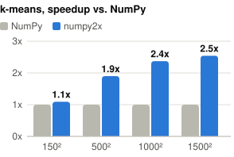
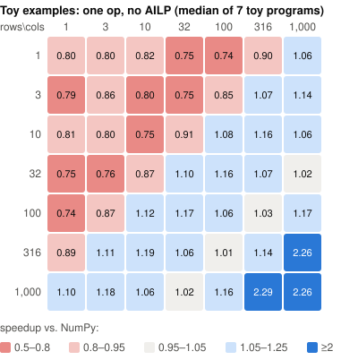

# numpy2x

**One switch. Two more cores. Your NumPy code, about 2x faster, with bit-identical results.**

```bash
python -m numpy2x prog.py        # instead of: python prog.py
```

numpy2x runs ordinary NumPy programs on two extra CPU cores. No annotations, no rewrite, no new
API: the same code, the same results down to the last bit, in less time. Free: Clear BSD
license for the code; the patent license ([PATENTS](PATENTS)) allows use with two worker
threads per process, also in your own cloud applications, but not on clusters.

## How it works, in one paragraph

numpy2x adds AILP (array instruction level parallelism) to NumPy: every NumPy operation (`a +
b`, `np.sin(x)`, `x.sum(axis=0)`, `a @ b`, ...) becomes a small task. Your Python thread only
issues these tasks and runs ahead; two worker threads compute them as soon as their inputs are
ready. Operations that do not depend on each other run at the same time, across loop iterations
and function calls. Each one is still computed by your installed NumPy's own code, called
exactly as NumPy calls it, so results are bit-identical to plain NumPy. The program waits only
where it reads a value (`print(x)`, `float(s)`, `if ...`).

## Examples

<table>
<tr>
<td>

**1. [A loop you cannot parallelize by hand](https://github.com/ILNumerics/numpy2x/blob/main/python/benchmarks/readme_examples.py#L52-L56)**

```python
for i in range(A.shape[1]):
    ES[:i + 1] = np.abs(np.sin(A[:, i])).sum()
```

Every iteration overwrites what the earlier ones wrote, so the iterations must not be
reordered: `multiprocessing`, a thread pool or `prange` would give wrong results. numpy2x
keeps exactly that order where it matters and overlaps everything else: 1.9x on a
1500 x 1500 matrix.

</td>
<td width="160"></td>
</tr>
<tr>
<td>

**2. [k-means](https://github.com/ILNumerics/numpy2x/blob/main/python/benchmarks/readme_examples.py#L59-L72)**, the program from the
[ILNumerics Accelerator](https://ilnumerics.net/auto-parallelizing-numerical-code.html)
[benchmarks](https://github.com/hokb/decentralized-array-execution-artifacts2026): a plain loop over the points, per point the distances to all centers and `argmin`,
then a center update per cluster (k = 50, k = 15 for the smallest size; 3 rounds). Already
faster on small data, and the more work each operation does, the more numpy2x gets out of
the two extra cores: 1.1x at 150 x 150 points, 1.9x at 500 x 500, 2.5x at 1500 x 1500.

</td>
<td width="310"></td>
</tr>
<tr>
<td>

**3. [Toy examples](https://github.com/ILNumerics/numpy2x/blob/main/python/benchmarks/shape_map_cases.py#L105-L193): no parallelism / too small data => no speed-up**

Complexity becomes performance: programs that loop over single scalar values or have only a few
instructions offer nothing to overlap and gain little; a single operation on small data can even
be a little slower than NumPy. Large arrays gain even without parallelism, most likely because of
more efficient memory management. The gain shows up as soon as a program does a few operations
on arrays of about 100 x 100 elements or more, as examples 1 and 2 do, and real programs usually
do much more than that.

</td>
<td width="310"></td>
</tr>
</table>

Intel Core i7-12700K, Windows 11, Python 3.13, NumPy 2.5.4, numpy2x with its 2 workers.
Examples 1 and 2: medians of 4 rounds (best of several runs each); example 3: the seven
single-op and dependent-chain programs of `python/benchmarks/shape_map_cases.py`. All results
bit-identical to NumPy. `python python/benchmarks/readme_examples.py` reproduces all of it
(results: [python/benchmarks/results/readme](https://github.com/ILNumerics/numpy2x/tree/main/python/benchmarks/results/readme)); your numbers
will depend on the machine and the program. How to measure your own code: [docs/testing.md](docs/testing.md).

## Usage

```bash
pip install numpy2x
```

Needs Python >= 3.12 (64 bit) and NumPy >= 2.5. Prebuilt wheels exist for Python 3.12 and 3.13
on Windows x64 and Linux x86_64; elsewhere pip builds from source, which needs a C++20 compiler
(GCC or Clang; Visual Studio with the C++ workload on Windows) and takes about a minute.

Then pick one:

```bash
python -m numpy2x prog.py        # run any program with numpy2x, no code change
NUMPY2X=1 python prog.py         # the same, through an environment variable
```

```python
import numpy2x as np             # or change one import line
```

Inside the program, `import numpy` gives numpy2x; installed libraries (SciPy, pandas, ...)
keep the real NumPy and read numpy2x arrays through NumPy's array protocols. Whatever numpy2x
does not run itself, NumPy runs, with NumPy's behavior. To compare, run `python prog.py` against
`python -m numpy2x prog.py`, or wrap a block in `with numpy2x.disabled():`.

Known differences, IDE setup and how to report results: [docs/testing.md](docs/testing.md).

## Where it comes from

numpy2x gets its core from [**viproc**](https://github.com/hokb/viproc), a remake of the
[ILNumerics Accelerator](https://ilnumerics.net/auto-parallelizing-numerical-code.html)
(proprietary, .NET). ILNumerics develops and uses strong-scaling methods that find the
parallel potential in sequentially written algorithms automatically and turn it into parallel
performance at runtime. numpy2x brings this to NumPy and runs on CPU cores. viproc and the
ILNumerics Accelerator also work on including GPUs and other OpenCL devices automatically.

## References

- Paper: [*A Virtual Processor brings back the Free Lunch*](https://arxiv.org/abs/2605.30507) (2026)
- Benchmark programs and results:
  [decentralized-array-execution-artifacts2026](https://github.com/hokb/decentralized-array-execution-artifacts2026)
- ILNumerics: [ilnumerics.net](https://ilnumerics.net)

## License

The code is under the Clear BSD License ([LICENSE](LICENSE)). numpy2x implements methods patented
by ILNumerics; their use is licensed separately in [PATENTS](PATENTS): free for numpy2x with at
most two worker threads per process, also with your own fixes and builds and in your own
applications and services, including on cloud infrastructure. Not covered: clusters (except for
testing, development and evaluation), offering numpy2x as part of a platform or managed service,
and products that offer NumPy-like array functions or objects computed with numpy2x. Those need a
commercial license from [ILNumerics](https://ilnumerics.net). Patents of ILNumerics:
[ilnumerics.net/patents.html](https://ilnumerics.net/patents.html). Third-party notices: [NOTICE](NOTICE).

Building from source, tests and Docker images: [docs/development.md](docs/development.md).
